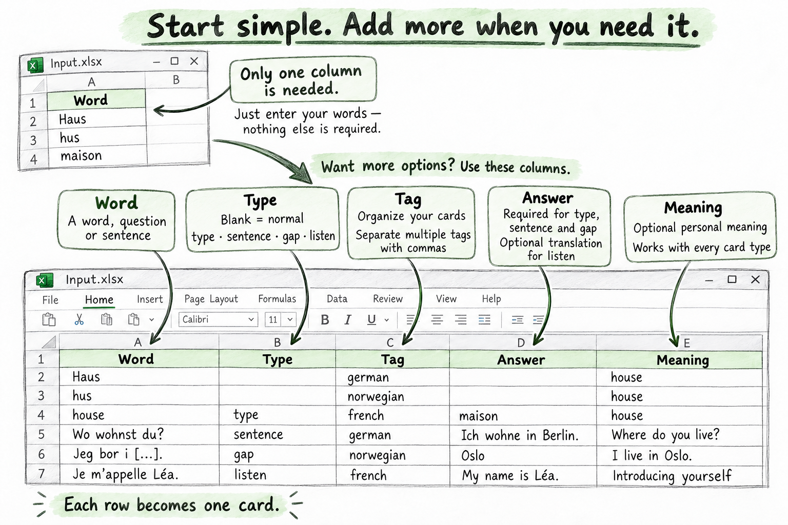

# Anki Card Generator

فهرست اکسل خودت را به دک آمادهٔ Anki تبدیل کن؛ همراه با معنی دیکشنری، مثال و تلفظ. با چند لغت ساده شروع کن یا تمرین تایپی، گفتاری، شنیداری و جای‌خالی را در همان فایل اضافه کن.

[English guide](README.md) · [راهنمای فنی](docs/technical_fa.md) · [یادداشت انتشار](CHANGELOG.md) · **v5.3.0**

## چطور کار می‌کند؟

**اکسل ← دیکشنری‌ها و صوت انتخابی ← دک Anki ← مرور در Anki یا AnkiDroid**

برنامه اکسل را می‌خواند، اطلاعات را از منابعی که فعال کرده‌ای می‌گیرد و کارت‌ها را با ظاهر یکپارچه و حالت تاریک می‌سازد. نتیجه‌های موفق دیکشنری و رسانه‌ها برای استفادهٔ بعدی کش می‌شوند. اگر یک منبع خطا بدهد، نتیجه‌های موجود ذخیره می‌شوند و خطا گزارش می‌شود.

برای انگلیسی و نروژی منابع دیکشنری اختصاصی وجود دارد. زبان‌های دیگر را می‌توان در تمرین‌ها یا منابع ترجمهٔ سازگار استفاده کرد؛ زبان‌ها را در `config.toml` انتخاب کن.

## اولین دک را بساز

**پایتون ۳٫۱۱ یا جدیدتر** لازم است. پروژه را دانلود یا کلون کن و ترمینال را در پوشهٔ آن باز کن.

**۱. یک بار نصب کن**

```powershell
python -m pip install -r requirements.txt
python -m playwright install chromium
```

**۲. کلمات را وارد کن**

از `Template.xlsx` یک کپی با نام `Input.xlsx` بساز. زیر هدر `Word` کلمات را بنویس؛ ستون‌های دیگر می‌توانند خالی بمانند. اکسل با فقط یک ستون `Word` هم کافی است.



مثال‌های آلمانی، نروژی و فرانسوی تصویر برای توضیح ساختارند. زبان برای اجرا تنظیم می‌شود؛ برنامه زبان هر ردیف را خودکار تشخیص نمی‌دهد.

**۳. تنظیمات را انتخاب کن**

بخش‌های موجود در **`config.toml`** را ویرایش کن:

| تنظیم | چه چیزی انتخاب می‌کنی؟ |
| --- | --- |
| `input.file` | فایل اکسل، مثلاً `Input.xlsx` |
| `language.source` | زبان لغت: `no` برای نروژی یا `en` برای انگلیسی |
| `sources.*.enabled` | دیکشنری‌هایی که روی کارت می‌خواهی |
| `anki.deck_name` | نام دک |
| `input.max_words` | `3` برای تست کوتاه؛ `0` برای همهٔ کلمات |

در کانفیگ عمومی فقط **Lexin بوکمال با معنی انگلیسی** فعال است. برای انگلیسی، زبان را `en` کن و منابع سازگار مثل Cambridge، Oxford یا Fastdic را فعال کن. تغییر زبان به‌تنهایی دیکشنری‌ها را فعال نمی‌کند.

نکته: در VS Code افزونهٔ پیشنهادی **Even Better TOML** را نصب کن تا `config.toml` رنگی و با بررسی خطا نمایش داده شود.

**۴. بساز و وارد Anki کن**

```powershell
python main.py --check
python main.py
```

فایل **`.apkg`** ساخته‌شده در `Output` را در Anki یا AnkiDroid باز کن؛ قالب کارت و رسانه‌های استفاده‌شده همراه آن هستند. برای به‌روزرسانی دک قبلی، شناسه‌های دک و مدل را ثابت نگه دار، برنامه را دوباره اجرا کن و بستهٔ جدید را وارد کن.

## وقتی امکانات بیشتری می‌خواهی

هر ردیف اکسل یک کارت می‌شود. برای لغت معمولی `Type` را خالی بگذار یا یکی از تمرین‌ها را انتخاب کن:

| نوع | تمرین |
| --- | --- |
| `type` | نوشتن پاسخ و مقایسهٔ آن در Anki |
| `sentence` | گفتن پاسخ نمونه و بررسی آن توسط خودت |
| `gap` | پرکردن یک یا چند جای خالی `[...]` |
| `listen` | شنیدن صوت و سپس دیدن متن |

ستون `Tag` برای دسته‌بندی، `Answer` برای پاسخ تمرین و `Meaning` برای معنی دلخواه است (قالب‌بندی اکسل حفظ می‌شود؛ با `[meaning] html = true` می‌توانی جدول و لینک HTML بنویسی). زبان تمرین را در `[practice]` تنظیم کن؛ پاسخ‌های لازم و مثال‌ها در [راهنمای فنی](docs/technical_fa.md#exercise-cards) آمده‌اند.

می‌توانی عکس را فعال کنی، دیکشنری‌ها و ترتیبشان را انتخاب کنی و پیش‌نمایش HTML با صوت یا گزارش اکسل بگیری. تنظیمات روزمره در `config.toml` است و برنامه با `main.py` اجرا می‌شود.

## اگر به مشکل خوردی

برای بررسی تنظیمات `python main.py --check` را اجرا کن. اگر مرورگر نصب نیست، دستور نصب Chromium را تکرار کن. خطای منابع در `Output/*_errors.json` ثبت می‌شود.

فهرست دیکشنری‌ها، تنظیمات پیشرفته، صوت، سازگاری Anki، رفع خطا، نگهداری کش و توسعه در [راهنمای فنی](docs/technical_fa.md) است. تغییرات نسخه‌ها و مهاجرت‌ها را در [یادداشت انتشار](CHANGELOG.md) ببین.
